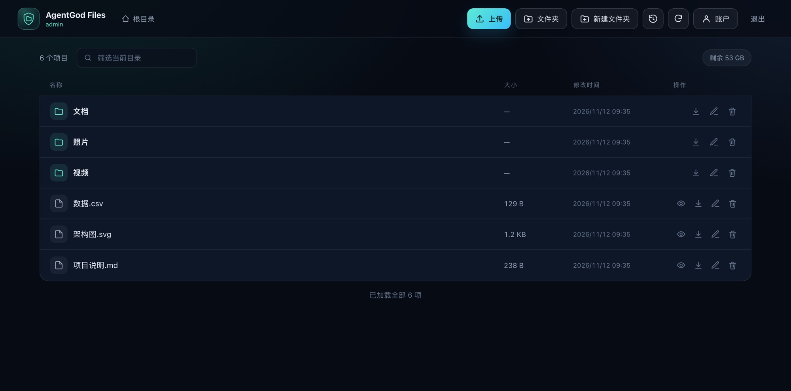
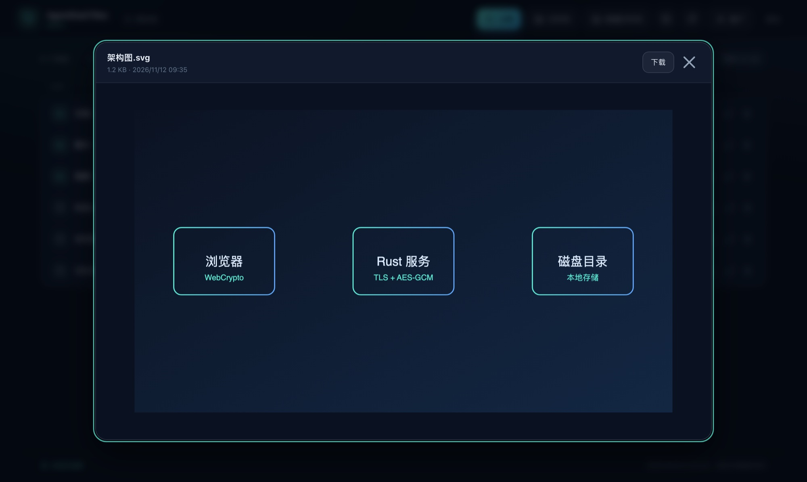

# AgentGod Files

一个用 Rust 编写的轻量级自托管文件服务器：单二进制、低内存占用，面向低功耗设备（ARM64 单板机、NAS、旧笔记本）设计。自带加密登录、应用层加密传输、在线预览、带宽与并发保护，用 Docker 一条命令即可部署。


## 目录

- [特性](#特性)
- [界面预览](#界面预览)
- [快速开始](#快速开始)
- [配置](#配置)
- [使用说明](#使用说明)
- [安全设计](#安全设计)
- [资源保护](#资源保护)
- [项目结构](#项目结构)
- [协议摘要](#协议摘要)
- [测试](#测试)
- [部署建议](#部署建议)
- [常见问题](#常见问题)
- [已知限制](#已知限制)
- [安全边界](#安全边界)
- [许可证](#许可证)

## 特性

- **文件管理**：目录浏览、新建文件夹、重命名、递归删除
- **批量与文件夹上传**：多选文件、整目录上传、拖拽文件夹，自动创建子目录并保留空目录
- **文件与文件夹下载**：单文件流式下载；文件夹服务端流式打包为未压缩 `.tar`
- **在线预览**：图片 / SVG、视频、音频、PDF、HTML（沙箱）、文本 / 代码 / JSON、CSV / TSV、Word（`.docx`）、Excel（`.xlsx` / `.xlsm`）
- **边收边看**：视频/音频/PDF 依赖 HTTP Range 流式播放，图片渐进显示，文本按块接收即时追加，Office 文档显示实时接收进度后再解析
- **预览快捷键**：视频 `←`/`→` 快退/快进 5 秒、`空格` 播放/暂停；图片 `←`/`→` 在目录内循环切换
- **浏览历史**：自动记录访问过的文件夹与打开的文件，点击记录可跳回对应目录并高亮目标文件
- **大目录分页**：目录扫描一次并缓存，前端按页加载（滚动到底自动续载），加载期间显示骨架屏
- **账户管理**：登录后可修改用户名和密码，其他会话立即失效
- **加密登录**：RSA-OAEP 包装随机会话密钥，Argon2id 校验密码
- **加密传输**：API 与上下载全程 AES-256-GCM，AEAD 附加数据绑定方法与 URI，防重放
- **HTTPS-only**：内置自签名证书生成，可替换为受信证书
- **资源保护**：全局令牌桶限速、传输/预览并发上限、磁盘安全余量、容器资源限制
- **单文件部署**：前端资源编译进二进制，运行时镜像约 15 MB，空闲内存约 1–3 MB

## 界面预览

> 截图使用演示数据。





## 快速开始

### 环境要求

- Docker 24+ 与 Docker Compose v2
- 一个用于存放文件的宿主机目录

### Docker Compose（推荐）

```bash
git clone https://github.com/fengqshanl/rs-file-broswer.git
cd rs-file-broswer

cp .env.example .env
# 至少修改 ADMIN_PASSWORD、FILES_DIR、LISTEN_IP
chmod 600 .env

docker compose up -d --build
docker compose ps
docker compose logs -f
```

启动后访问 `https://<LISTEN_IP>:8090/`。默认只绑定 `127.0.0.1`，如需局域网访问，把 `.env` 中的 `LISTEN_IP` 改为服务器内网地址（不要直接暴露公网）。

首次启动会自动生成：

| 文件 | 用途 |
| --- | --- |
| `state/rsa_private.pem` | 登录用 RSA 私钥（0600） |
| `state/tls/cert.pem` / `state/tls/key.pem` | 自签名 TLS 证书与私钥 |
| `state/credentials.json` | 管理员凭据哈希（0600，首次登录前创建） |

自签名证书首次访问会提示不安全，选择「高级 → 继续前往」即可。浏览器的 WebCrypto 要求安全上下文，因此服务只提供 HTTPS，不提供明文 HTTP。

### Docker 单容器

```bash
docker build -t agentgod-files .

docker run -d --name agentgod-files \
  --restart unless-stopped \
  --read-only --tmpfs /tmp:size=16m \
  --cap-drop ALL --cap-add DAC_OVERRIDE --cap-add DAC_READ_SEARCH \
  --security-opt no-new-privileges:true \
  --memory 256m --cpus 1.0 --pids-limit 128 \
  -p 127.0.0.1:8090:8090 \
  -v /path/to/files:/data/files \
  -v "$PWD/state:/data/state" \
  -e ADMIN_PASSWORD='change-me-to-a-long-random-password' \
  -e TLS_EXTRA_IPS=127.0.0.1 \
  agentgod-files
```

> 容器以 root 运行，因为需要读写宿主机上 root 拥有的目录。请配合上面的 capability 裁剪、只读根文件系统与资源限制使用。

### 从源码运行

需要 Rust 1.82+：

```bash
export DATA_ROOT=/path/to/files
export TMP_ROOT=/path/to/files/.agentgod-tmp
export STATE_DIR=$PWD/state
export ADMIN_USER=admin
export ADMIN_PASSWORD='change-me-to-a-long-random-password'
export BIND=127.0.0.1
export PORT=8090
cargo run --release
```

## 配置

所有配置通过环境变量提供。Docker Compose 会从 `.env` 读取同名变量。

| 变量 | 默认值 | 说明 |
| --- | --- | --- |
| `ADMIN_USER` | `admin` | 初始管理员用户名（仅首次初始化凭据时使用） |
| `ADMIN_PASSWORD` | 必填 | 初始密码，至少 8 个字符 |
| `ADMIN_PASSWORD_HASH` | 空 | 可选，Argon2id PHC 字符串；设置后优先于明文密码 |
| `LISTEN_IP` | `127.0.0.1` | 宿主机监听地址；局域网访问改为内网 IP 或 `0.0.0.0` |
| `HOST_PORT` | `8090` | 宿主机端口 |
| `FILES_DIR` | `./data` | 对外提供的宿主机目录（挂载到容器 `/data/files`） |
| `TLS_EXTRA_IPS` | `127.0.0.1` | 证书 SAN 中额外包含的 IP，逗号分隔 |
| `TLS_EXTRA_DNS` | `localhost` | 证书 SAN 中额外包含的域名 |
| `UPLOAD_RATE_MBPS` | `20` | 全局上传限速（MB/s），`0` 为不限速 |
| `DOWNLOAD_RATE_MBPS` | `30` | 全局下载与预览限速（MB/s），`0` 为不限速 |
| `MAX_CONCURRENT_UPLOADS` | `2` | 并发上传数（1–16） |
| `MAX_CONCURRENT_DOWNLOADS` | `2` | 并发下载数（1–16） |
| `MAX_CONCURRENT_PREVIEWS` | `4` | 并发预览请求数（1–32） |
| `MAX_ACTIVE_UPLOADS` | `32` | 同时存在的未完成上传会话上限 |
| `MAX_FILE_SIZE_GB` | `100` | 单文件大小上限（GB） |
| `DISK_RESERVE_MB` | `2048` | 磁盘保留空间（MB），上传不会挤占该余量 |
| `SESSION_TTL_SECS` | `7200` | 会话滑动有效期（秒） |
| `SESSION_MAX_TTL_SECS` | `86400` | 会话绝对有效期上限（秒） |
| `RSA_BITS` | `2048` | 首次生成 RSA 私钥长度（2048/3072/4096） |
| `LOGIN_MAX_FAILURES` | `8` | 登录失败次数上限 |
| `LOGIN_WINDOW_SECS` | `600` | 登录失败计数与封禁窗口（秒） |
| `TZ` | `Asia/Shanghai` | 容器时区 |

构建参数（可选，用于选择基础镜像）：

```bash
docker build \
  --build-arg RUST_IMAGE=rust:1-alpine \
  --build-arg ALPINE_IMAGE=alpine:3.20 \
  -t agentgod-files .
```

在中国大陆网络下可以改用镜像源，例如 `docker.1ms.run/library/rust:1-alpine`。

### 使用受信证书

把证书与私钥放到 `state/tls/cert.pem` 和 `state/tls/key.pem`，然后重启容器。证书需覆盖你实际访问的域名或 IP，此后浏览器不再提示自签名警告。

### 重置管理员凭据

如果忘记密码，删除 `state/credentials.json` 并重启容器，会重新使用 `.env` 中的 `ADMIN_USER` / `ADMIN_PASSWORD` 初始化：

```bash
rm state/credentials.json
docker compose up -d --force-recreate
```

## 使用说明

- **上传**：点击「上传」多选文件；点击「文件夹」选择整个目录；也可以把文件或文件夹直接拖进页面
- **下载**：文件行右侧的下载按钮；文件夹会打包为 `<名称>.tar` 下载
- **预览**：点击文件名或眼睛图标。图片、视频、音频、PDF、HTML、文本、Office 文档均可在线查看
- **快捷键**：预览打开时，视频 `←`/`→` 快退/快进 5 秒、`空格` 播放/暂停；图片 `←`/`→` 循环切换目录内图片
- **账户**：点击右上角「账户」或左上角用户名，可修改用户名与密码
- **历史**：点击工具栏时钟图标，可查看最近访问的文件夹与文件；点击记录回到对应目录并高亮该文件，可一键清空
- **大目录**：首次打开会显示骨架屏，列表滚动到底自动加载下一页；底部也会显示「加载更多」按钮
- **筛选**：工具栏搜索框按名称过滤**已加载**的项目；大目录可继续滚动加载后再筛选

## 安全设计

### 传输与登录

1. **TLS 1.2 / 1.3**：服务只监听 HTTPS，浏览器必须处于安全上下文才能使用 WebCrypto。
2. **登录（非对称）**：浏览器拉取 RSA 公钥，生成随机 AES-256 会话密钥并用 `RSA-OAEP-SHA256` 包装；用户名、密码、客户端时间戳以 AES-256-GCM 加密后发送；服务器解密后用 Argon2id 校验密码并签发随机会话令牌。
3. **数据（对称）**：所有 API 请求/响应 JSON 使用 AES-256-GCM，AAD 绑定 `方法 + URI`，密文不能跨接口重放。
4. **上传**：按 2 MiB 分块加密，服务器校验分块序号、声明大小与 GCM 标签，完成后在同一文件系统内原子重命名。
5. **下载**：64 KiB 流式加密帧 `[u32 长度][12B nonce][密文+tag]`，每帧 AAD 含序号；文件夹归档额外带结束标记，客户端校验完整性。
6. **密码存储**：Argon2id（默认参数），也可直接提供 `ADMIN_PASSWORD_HASH`。
7. **会话**：32 字节随机令牌，放在 `Authorization: Bearer` 头中（不使用 Cookie，天然规避 CSRF）；滑动过期 + 绝对上限；刷新页面会丢失内存中的会话密钥，需要重新登录。
8. **爆破防护**：按来源 IP 限制登录失败次数，Argon2 校验并发限制为 2，避免登录请求打满 CPU。
9. **路径安全**：拒绝 `..`，对目标做 canonicalize 并校验位于数据根目录内；临时上传目录对外不可见；删除符号链接只删除链接本身。
10. **浏览器侧**：严格 CSP（无内联脚本/样式）、`X-Frame-Options: DENY`、`nosniff`、无 Referrer、同源限制；文件名通过 `textContent` 渲染，避免 XSS。

### 文件预览的安全模型

`<video>` / `` / `<iframe>` 无法携带 `Authorization` 头，视频拖动进度条还依赖 HTTP Range，因此预览使用独立令牌：

- 登录后通过加密 API 为单个文件签发 43 字符随机令牌，默认 60 分钟有效，绑定当前会话；
- `GET /preview/<token>` 支持 `Range`，按扩展名返回正确 `Content-Type`，仍受全局下载限速与预览并发限制；内容经 TLS 加密传输，但**不再叠加应用层 AES-GCM**；
- 登出、修改账户、会话过期会立即吊销对应令牌；
- HTML / SVG / XML 响应强制 `Content-Security-Policy: sandbox ...`，并配合 `iframe sandbox`（无 `allow-same-origin`），使其运行在独立不透明源，无法读取本应用的 DOM、令牌或调用已认证接口；
- Word / Excel 完全在浏览器本地解析（仓库内打包的 mammoth.js 与 SheetJS，按需加载），文件不会发送给第三方；docx 生成的 HTML 在插入前经过白名单清洗。

> 应用层加密保护的是「浏览器 ↔ 本服务」这条会话。自签名证书需要手动信任；若用户在已被 MITM 的环境里强行信任伪造证书，应用层密钥交换无法阻止。需要严格防护时请使用受信证书。

### 资源保护

- **全局令牌桶限速**：上传、下载（含预览）各自一个全局桶，所有连接共享，而不是每连接限速。
- **并发上限**：默认 2 个上传 + 2 个下载，预览另设 4 个并发；其余请求排队。
- **内存可控**：下载块 64 KiB、上传块最大 4 MiB，流式处理，不缓存整个文件；预览同样流式，单次读取 64 KiB。
- **磁盘安全余量**：拒绝任何会占用「剩余空间 − 2 GiB」的上传，分块写入时持续检查。
- **大目录保护**：目录在阻塞线程中一次扫描并排序，结果缓存 15 秒（最多缓存 2 个目录），前端每页 300 项；单目录上限 50,000 项。这样翻页不会反复遍历目录，也不会把数万个 DOM 节点一次性塞进浏览器。
- **容器限制**：示例配置使用 256 MB 内存、1 CPU、128 PID、只读根文件系统、丢弃全部 capability（仅保留文件访问所需的 `DAC_OVERRIDE` / `DAC_READ_SEARCH`），日志轮转 10 MB × 3。
- **登录 CPU 保护**：Argon2 并发信号量 + 失败退避。

## 项目结构

```
src/
  main.rs        启动、TLS 监听、优雅关闭、资源限制日志
  config.rs      环境变量解析与校验
  credentials.rs 管理员凭据持久化
  auth.rs        登录、会话提取器、登录限流、账户修改
  crypto.rs      RSA-OAEP / AES-256-GCM / Argon2 / AAD
  api.rs         加密请求读取与加密响应
  files.rs       浏览、批量/文件夹上传、下载、重命名、删除
  archive.rs     流式 tar 打包（目录下载）
  preview.rs     预览令牌、Range 支持、MIME 推断、沙箱策略
  rate.rs        全局令牌桶
  state.rs       应用状态、上传会话、会话表、预览令牌
  tls.rs         自签名证书生成/复用
  web.rs         路由、CSP、安全响应头、静态资源
static/          嵌入式 Web UI（原生 JS + WebCrypto，无外部依赖）
static/vendor/   Word/Excel 本地解析库（仅预览时按需加载）
scripts/         Node E2E 协议测试、Chrome UI 冒烟测试、测试视频生成
Dockerfile       Alpine + musl 构建
docker-compose.yml
```

## 协议摘要

| 步骤 | 内容 |
| --- | --- |
| `GET /api/pubkey` | 返回 RSA 公钥 PEM |
| `POST /api/login` | `{ek, iv, ct}`：RSA-OAEP 包装的会话密钥 + AES-GCM 加密的 `{username,password,ts}` |
| 登录响应 | AES-GCM 加密的 `{token,expires_in,user}`，AAD = `login-resp` |
| 其他 API | `Authorization: Bearer <token>` + `{iv,ct}`，AAD = `<METHOD> <URI>` |
| `POST /api/list` | 加密 `{path, offset, limit}` → 当前页目录项、`total`、`has_more`、剩余空间（扫描结果服务端缓存 15 秒） |
| `POST /api/mkdir` / `ensure_dirs` | 创建单个/批量文件夹 |
| `POST /api/rename` / `delete` | 重命名、递归删除 |
| `POST /api/upload/init` | 加密 `{dir,name,size}` → `{id}` |
| `PUT /api/upload/chunk/{id}/{seq}` | 原始加密帧 `[u32 ct_len][12B iv][ct]`，响应加密 JSON |
| `POST /api/upload/finish` | 校验大小并原子移动；`/abort` 清理临时文件 |
| `POST /api/download` | 加密 `{path}`；响应为带 `x-file-size`/`x-chunk-size` 的加密帧流 |
| `POST /api/download_folder` | 加密 `{path}`；tar 加密帧流，最后一帧为 `AGF_TAR_END_v1` |
| `POST /api/preview/token` | 加密 `{path}` → `{url,name,size,content_type,expires_in}` |
| `GET /preview/<token>` | Range 预览，完整支持单段 `bytes=` 请求，大文件不截断（仅 TLS，见预览安全模型） |
| `POST /api/account/update` | 加密 `{current_password,new_username,new_password}`，改密后吊销其他会话 |
| 下载帧 | `[u32 ct_len][12B iv][ct]`，AAD = `dl:<seq>` |

## 测试

```bash
# Rust 单元测试
cargo test
```

本地启动服务（用于下面的 E2E 与 UI 测试）：

```bash
mkdir -p testdata/files testdata/state

DATA_ROOT=$PWD/testdata/files \
TMP_ROOT=$PWD/testdata/files/.agentgod-tmp \
STATE_DIR=$PWD/testdata/state \
TLS_DIR=$PWD/testdata/state/tls \
ADMIN_USER=admin \
ADMIN_PASSWORD='local-test-password-123' \
BIND=127.0.0.1 PORT=18443 TLS_EXTRA_IPS=127.0.0.1 \
UPLOAD_RATE_MBPS=0 DOWNLOAD_RATE_MBPS=0 \
cargo run
```

端到端协议测试（登录失败、加密 API、路径穿越、分块上传、嵌套目录、流式下载哈希、文件夹 tar、预览 Range、沙箱 HTML、账户修改与他人会话吊销等）：

```bash
BASE_URL=https://127.0.0.1:18443 \
ADMIN_PASSWORD='local-test-password-123' \
NODE_TLS_REJECT_UNAUTHORIZED=0 \
node scripts/e2e-test.mjs
```

浏览器 UI 冒烟测试（需要本地 Chrome 与调试端口；视频快捷键测试需要 ffmpeg 生成 6 秒测试片段）：

```bash
"/Applications/Google Chrome.app/Contents/MacOS/Google Chrome" \
  --headless=new --remote-debugging-port=9223 \
  --user-data-dir=/tmp/agentgod-chrome --ignore-certificate-errors about:blank &

./scripts/make-test-video.sh /tmp/agentgod-ui-test.webm

CHROME_DEBUG_URL=http://127.0.0.1:9223 \
UI_URL=https://127.0.0.1:18443/ \
ADMIN_PASSWORD='local-test-password-123' \
node scripts/ui-smoke.mjs
```

## 部署建议

- **只绑定内网地址**：默认 `127.0.0.1`。需要远程访问时绑定 Tailscale / WireGuard / 局域网 IP，或放在已有 VPN 之后。
- **不要直接暴露公网**：本项目的定位是私有文件入口，没有多用户隔离、审计与防病毒能力。
- **使用受信证书**：如果通过域名访问，建议放置受信证书或由反向代理终止 TLS（反向代理需支持大文件与 Range 透传）。
- **备份**：文件在 `FILES_DIR`；`state/` 保存 RSA 私钥、TLS 证书与凭据哈希，建议一起备份。
- **升级**：替换镜像后 `docker compose up -d`。上传过程中重启会让未完成上传失效，临时文件会在下次启动时清理。
- **观察**：`docker stats agentgod-files` 通常只有数 MB 内存；若持续升高，检查限速与并发配置。

## 常见问题

**用 `http://` 访问报 `curl: (1) Received HTTP/0.9` 或浏览器直接报错？**

服务只提供 HTTPS。请使用 `https://`，自签名证书需要加 `-k`（curl）或手动信任（浏览器）。

**页面登录后刷新就需要重新登录？**

会话密钥只保存在页面内存中，这是有意设计。刷新会丢弃密钥。

**浏览器提示「当前页面不是安全上下文」？**

说明你用的是 `http://` 或证书未被信任，WebCrypto 因此不可用。请改用 HTTPS 并信任证书。

**大文件下载失败，提示超过 1 GB？**

不支持 File System Access 的浏览器会回退为内存 Blob，上限 1 GiB。建议使用 Chrome / Edge。

**视频无法播放？**

浏览器不支持该容器或编码（例如 H.265/HEVC、部分 MKV）。可下载后用本地播放器打开；mp4（H.264）与 webm（VP8/VP9）兼容性最好。

**`.doc` / `.xls` / `.pptx` 无法预览？**

当前只支持 `.docx` 与 `.xlsx` / `.xlsm` 的本地解析，旧版二进制格式与演示文稿请下载查看。

**修改密码后其他设备被登出？**

这是预期行为：修改账户会吊销其他会话与预览令牌，当前会话保持登录。

## 已知限制

- 单管理员、单租户，没有多用户与权限分组
- 不支持断点续传
- 不支持在线预览旧版 Office（`.doc`/`.xls`）与 `.pptx`
- HTML 预览只加载单文件，依赖同目录 CSS/JS/图片的站点无法完整显示
- 文件夹下载为未压缩 tar（降低 CPU 占用），下载后需自行解压
- 表格预览最多 2000 行 × 80 列；Word/Excel 预览上限 64 MB（需完整接收后解析，期间显示进度）；文本流式显示上限 32 MB
- 单目录最多显示 50,000 项；筛选只作用于已加载的分页内容
- 浏览历史保存在浏览器 `localStorage`（最多 300 条），不跨浏览器同步
- 文件在宿主机磁盘上不额外加密存储，访问控制依赖容器与宿主机文件权限

## 安全边界

本项目按「带认证的私有文件管理入口」设计，请只绑定内网或 VPN 地址，并妥善保管密码。它不提供多租户隔离、持久化审计、病毒扫描或文件类型限制，不建议直接暴露到公网。发现安全问题请通过仓库 issue 私下联系维护者，不要公开披露细节。

## 许可证

[MIT](LICENSE)。第三方前端库许可见 [`static/vendor/NOTICE.md`](static/vendor/NOTICE.md)。

## 贡献

欢迎提交 Issue 与 Pull Request。提交前请确保：

```bash
cargo fmt
cargo clippy -- -D warnings
cargo test
```
